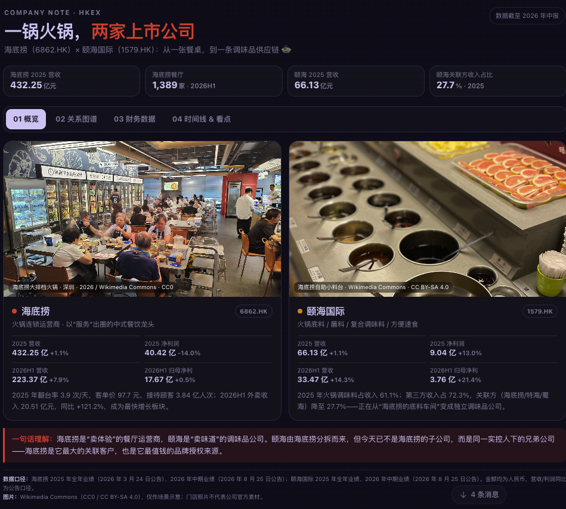
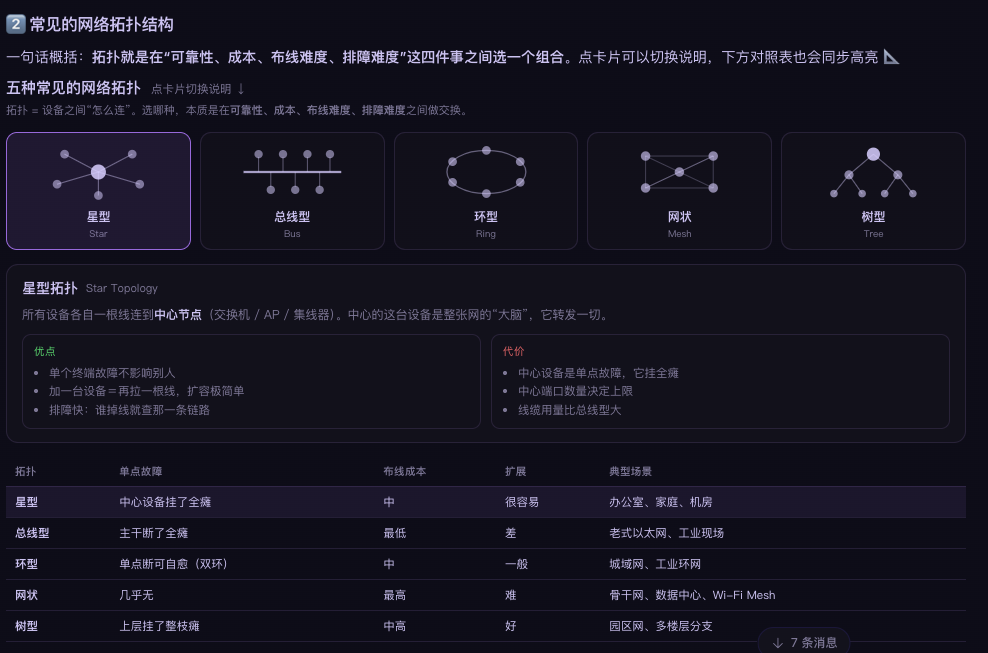
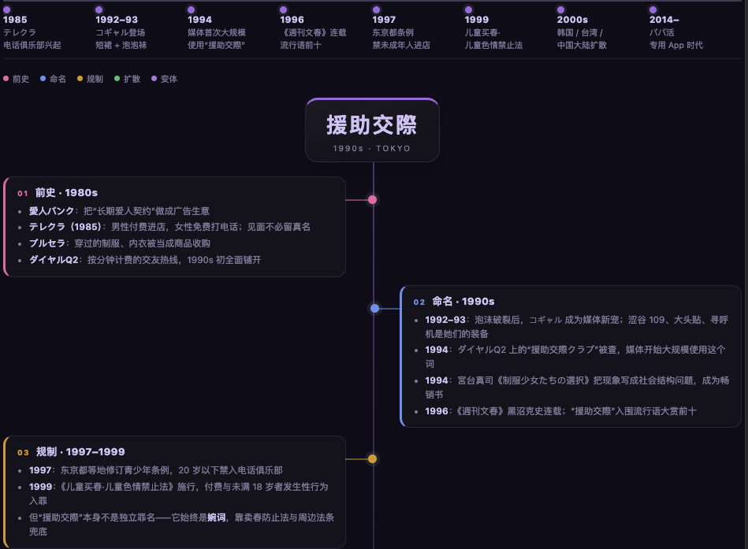

# Hermes Visualization

Presentation patterns for answering **with visuals inside a chat surface**: inline HTML widgets, framed
image galleries, mind maps, timelines, comparison grids and small charts.

The point is not "make it pretty" — it is that structural content (a taxonomy, a sequence, a set of
options, a system) is *faster to read as a picture than as prose*, and that a picture the reader can
**click** answers follow-up questions without another round-trip.

## What this is

A single Hermes skill, `chat-rich-media`, that teaches an agent:

- **which** form to reach for (gallery / mind map / timeline / grid / chart / plain markdown),
- **how** to build it so it survives the chat frame (theme variables, fluid width, height budget,
  breakpoints, no dead space),
- **how** to source and license images, and how to check you have the right subject,
- **how** to verify the result — measure it, resize it, click it — instead of shipping a screenshot and
  hoping.

## Examples

Three answers built with this skill, screenshotted from real sessions. Copy the **structure**; the copy in
them is illustrative. Each is one HTML file plus one `::preview{file="/abs/path.html"}` directive.

### 1. A company note — two listed companies behind one hotpot chain



Opens with four KPI cards (revenue, store count, supplier revenue, related-party share) — the numbers that
decide whether the rest is worth reading. Then a tab bar carries four readings (overview / relationship
graph / financials / timeline) so one answer does not become four screens of scroll. The photo tiles are
evidence of *place*, captioned and licence-labelled, not decoration. Two company cards hold revenue, profit,
half-year figures and the one operational detail that explains the split; a single bold line states the
argument in a sentence, and the footnote gives the data basis, image licences and the not-advice caveat.

Worth copying: KPI-first hierarchy · tabs instead of a long scroll · every number with a unit and a period ·
a footer that says where the numbers came from.

### 2. Five ways a network can be wired



Five hand-drawn SVG shapes, one selected. The panel underneath explains the selection in two columns
(strengths / costs), and the comparison table keeps every option on screen with the selected row
highlighted. Clicking a shape changes all three at once — shape, panel, table row.

Worth copying: selection instead of enumeration · the table stays as the scan surface while the detail
explains · shapes drawn at `viewBox="0 0 120 66"` in `currentColor` so they follow the theme.

This one is `templates/diagram-grid.html` filled in.

### 3. A concept's history as a mind map



A topic that is both chronological and thematic: the root sits in the middle, a vertical rail carries the
periods, and each branch card argues one phase — prehistory, naming, regulation. The strip across the top is
a timeline that doubles as a legend, so the reader gets the shape before reading a word.

Worth copying: when time *and* argument both matter, put time on the rail and the argument in the cards ·
colour-code the categories once, then reuse the same hue in the legend and the dots.

The subject is a sensitive social topic, so the answer is text and structure only — no decorative imagery,
which is the rule for legal, medical and grief topics too.

## Install

```bash
# canonical: through the Skills Hub
hermes skills install Tangtangchannel/hermes-visualization/skills/chat-rich-media
```

No hub, no network, or a proxy that the guard refuses (a fake-IP range such as `198.18.0.0/15` makes the
hub client treat `api.github.com` as an internal address and refuse it) — clone and copy instead:

```bash
git clone https://github.com/Tangtangchannel/hermes-visualization.git
cp -r hermes-visualization/skills/chat-rich-media "$HERMES_HOME/skills/"
```

Then load it with `skill_view(name="chat-rich-media")` in any session.

## Layout

```
skills/chat-rich-media/
├── SKILL.md                     the contract: when, what, how, pitfalls
├── references/
│   ├── patterns.md              seven layout recipes, with structure sketches
│   ├── image-sourcing.md        search, license, and identity verification
│   └── widget-verification.md   the render → measure → click → screenshot loop
└── templates/
    ├── gallery.html             subject profile: photo tiles + key facts + timeline strip
    ├── mindmap.html             one root, N branches, working connector rails
    ├── timeline.html            expandable events, category filter, replay control
    └── diagram-grid.html        hand-drawn SVG shapes + click-to-explain panel
```

Templates are skeletons, not demos: they render standalone with placeholder blocks, and carry `TODO`
comments where the content goes. Copy one, replace the copy, keep the layout.

`docs/examples/` holds the screenshots used in the section above.

## Design constraints that matter

- The chat frame is themed at runtime. Everything is coloured from `--foreground`, `--muted-foreground`,
  `--accent`, `--border`, `--card`; no hardcoded palettes, no `background` on `body`.
- Width follows the column (up to ~960px), height follows content (up to ~1200px). A widget that assumes
  its authoring width breaks at the first resize.
- Grid tracks are `repeat(N, minmax(0, 1fr))`. A bare `1fr` overflows on long unbroken strings.
- Images inside a widget: relative `src` plus an `onerror` swap to a remote URL, because the frame's loader
  may not resolve the same base path a local `file://` check did.
- Nothing decorative on legal, medical or grief topics — those answers stay text.

## License

GPL-3.0 (see `LICENSE`). Templates are meant to be copied and modified; the share-alike terms apply to
distribution, not to the widgets you build for yourself.
